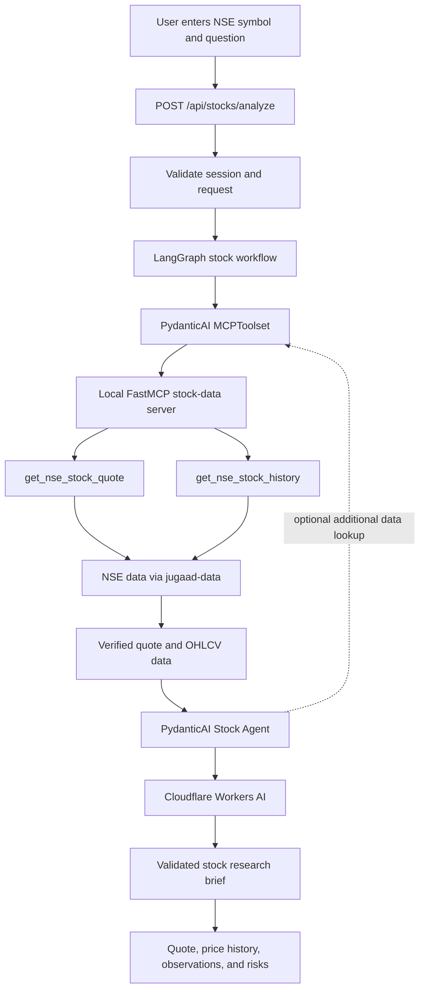

# MarketBrief AI

MarketBrief AI researches Indian NSE-listed stocks. A single PydanticAI **Stock Agent** uses local MCP tools backed by [`jugaad-data`](https://github.com/jugaad-py/jugaad-data) to retrieve the latest available NSE quote and recent EQ-series history. The verified data is passed to Cloudflare Workers AI for a concise, typed research brief. The app does not provide personalized investment advice or buy/sell instructions.

## Configure Cloudflare Workers AI

Create a Cloudflare API token with Workers AI access, then copy the backend environment example and fill in the account ID and token:

```bash
cp backend/.env.example backend/.env
```

`CLOUDFLARE_MODEL` selects the text model. The default is `@cf/meta/llama-3.1-8b-instruct`. The model is called through Cloudflare's OpenAI-compatible Workers AI endpoint; the app does not use Ollama.

## Start the backend

Install the backend dependencies from the repository root:

```bash
conda activate samjhao-ai
python -m pip install -r backend/requirements.txt
```

Start PostgreSQL and the API:

```bash
docker compose up -d postgres
python -m uvicorn main:app --app-dir backend --reload
```

The API docs are at `http://127.0.0.1:8000/docs`; health check is `http://127.0.0.1:8000/api/health`.

## Start the frontend

In another terminal from the repository root:

```bash
cd frontend
npm install
npm run dev
```

Open `http://localhost:5173`. The frontend sends API requests to the backend on port 8000.

## Local PostgreSQL and authentication

The Compose database defaults are:

```text
Host:     127.0.0.1
Port:     5432
Database: samjhao
User:     samjhao
Password: samjhao_local_dev
```

To create the first administrator, run this from `backend/`:

```bash
python -m auth.cli create-admin
```

Public sign-up creates user accounts. Admins can create users, suggest an initial password, list accounts, and change account roles in the **Users** section. Users sign in with their email or username. Sessions use HTTP-only cookies backed by PostgreSQL.

| Method | Endpoint | Access |
| --- | --- | --- |
| POST | `/api/auth/signup` | Public; creates a user and signs them in |
| POST | `/api/auth/login` | Public; email or username |
| GET | `/api/auth/me` | Signed in |
| POST | `/api/auth/logout` | Signed in |
| GET | `/api/admin/users` | Admin |
| POST | `/api/admin/users` | Admin; creates a user |
| PATCH | `/api/admin/users/{user_id}/role` | Admin |
| POST | `/api/stocks/analyze` | Signed in |

## Stock research flow

`POST /api/stocks/analyze` accepts a stock symbol, a question, and a history range from 1 to 365 days. NSE symbols such as `RELIANCE`, `SBIN`, and `TCS` are supported. The API validates the symbol and routes the request through LangGraph to the single Stock Agent.

```json
{
  "symbol": "RELIANCE",
  "question": "Summarize the latest quote and recent trend",
  "history_days": 30
}
```



The MCP server exposes two tools: latest quote and bounded historical OHLCV data. Historical output is limited to the latest 30 trading points. The exact quote and history are returned separately from the AI summary so the UI can display the fetched numbers directly. The server and MCP client run locally within the backend process; no extra MCP server command is needed.

Data availability depends on NSE responses and market hours. A returned quote may not represent a real-time executable price. Research summaries are informational and are not investment recommendations.

## Live terminal routing logs

Uvicorn prints a box for each workflow stage. The request ID connects route, MCP, and model activity:

```text
┌────────────────────────────────────────────────────────────────────────┐
│ a1b2c3d4 | LANGGRAPH ROUTING                                           │
│ NSE:RELIANCE → Stock Agent → NSE MCP data tools                       │
└────────────────────────────────────────────────────────────────────────┘
┌────────────────────────────────────────────────────────────────────────┐
│ a1b2c3d4 | MCP TOOL CALL                                               │
│ get_nse_stock_quote(symbol=RELIANCE)                                    │
└────────────────────────────────────────────────────────────────────────┘
┌────────────────────────────────────────────────────────────────────────┐
│ a1b2c3d4 | MCP TOOL CALL                                               │
│ get_nse_stock_history(symbol=RELIANCE, days=30)                        │
└────────────────────────────────────────────────────────────────────────┘
```

Logs include request IDs, symbols, and workflow stage names; user questions and credentials are not logged.

## Backend layout

```text
backend/
├── auth/                     # Authentication and role-based access
├── app/
│   ├── agents/
│   │   ├── model.py          # Cloudflare Workers AI model client
│   │   └── stock_agent.py    # Single PydanticAI agent + MCP toolset
│   ├── api/routes/
│   │   ├── health.py
│   │   └── stocks.py         # Authenticated stock-analysis endpoint
│   ├── core/                 # Settings and terminal flow logs
│   ├── mcp_servers/
│   │   └── stock_data.py     # FastMCP tools backed by jugaad-data
│   ├── prompts/
│   │   └── stock_analysis.py
│   ├── schemas/
│   │   └── stock.py          # Request, quote, history, and brief schemas
│   └── workflows/
│       └── stock_analysis.py # LangGraph route and request workflow
└── main.py
```

Analysis history is kept in browser memory for the current session. User accounts and login sessions are stored in PostgreSQL.
