# MarketBrief AI

**An AI-powered research workspace for Indian NSE stocks.**

MarketBrief AI brings market snapshots, historical price charts, stock research, and recent news or public web coverage into one responsive dashboard. It uses NSE data through `jugaad-data`, LangGraph workflows, PydanticAI agents, and Cloudflare Workers AI.

> Market data may be delayed or unavailable outside market hours. Research summaries are informational and are not personalized investment advice or buy/sell recommendations.

## What we are building

- **NSE market watch:** Search the NIFTY 500 snapshot in a responsive table or an interactive node graph. Drag nodes to rearrange them, or click one to open its price details.
- **Stock charts:** View daily stock history as a line, area, or candlestick chart. Candlesticks use NSE open, high, low, close, and volume data.
- **Stock Agent:** Ask a question about an NSE symbol. The Stock Agent combines verified NSE quote and history data with a typed AI research brief.
- **Market Catalyst Agent:** Look up recent news and publicly indexed web or social results related to a stock, with links back to the sources.
- **Accounts and roles:** Sign up and log in with an email or username. Admins can manage user accounts and roles.
- **Responsive workspace:** Switch between light and charcoal themes; use the dashboard on desktop, tablet, or mobile.

Market watch checks for updated snapshots periodically. This is **snapshot data**, not a tick-by-tick exchange feed; values change when new data is available from the source.

## How a stock research request works

```mermaid
flowchart LR
    User[User] --> API[Public API :8000]
    API --> Auth[Session and request validation]
    Auth --> AIS[Private AI service :8001]
    AIS --> Graph[LangGraph workflow]
    Graph --> MCP[Local NSE MCP tools]
    MCP --> NSE[jugaad-data and NSE]
    NSE --> Agent[PydanticAI Stock Agent]
    Agent --> CF[Cloudflare Workers AI]
    CF --> Result[Typed research brief]
    Result --> UI[MarketBrief dashboard]
```



The public API handles authentication and normal HTTP requests. Longer AI workflows run in a separate service on port `8001`. The Stock Agent can use the local NSE MCP tools; the Market Catalyst Agent searches GDELT news and public web/social results in parallel before summarizing linked sources. Cloudflare credentials are needed for AI-generated summaries.

## Technology

| Area | Technology |
| --- | --- |
| Frontend | React 19, Vite 8, responsive CSS |
| Public API | FastAPI, Python 3.11 |
| AI service | FastAPI on port `8001` |
| Agent workflows | LangGraph and PydanticAI |
| Language model | Cloudflare Workers AI (OpenAI-compatible endpoint) |
| Market data | `jugaad-data` through local FastMCP tools |
| News and public web search | GDELT and DDGS |
| Authentication and roles | PostgreSQL, SQLAlchemy, HTTP-only session cookies |
| Local database | Docker Compose and PostgreSQL |

No Ollama server is used.

## Local setup

### 1. Install prerequisites

- Python 3.11
- Node.js and npm
- Docker Desktop with Docker Compose
- Cloudflare Workers AI account ID and API token for AI summaries

### 2. Configure the backend

Run these commands from the repository root:

```bash
cp -n backend/.env.example backend/.env
```

Open `backend/.env` and set `CLOUDFLARE_ACCOUNT_ID` and `CLOUDFLARE_API_TOKEN`. The default model is `@cf/meta/llama-3.1-8b-instruct`. Keep this local file private; it is ignored by Git.

Create and activate a Python environment, then install dependencies:

```bash
conda create -n marketbrief-ai python=3.11 -y
conda activate marketbrief-ai
python -m pip install -r backend/requirements.txt
```

If you already have a Python 3.11 environment, activate it instead of creating another one.

### 3. Start PostgreSQL

From the repository root:

```bash
docker compose up -d postgres
docker compose ps
```

The local defaults are `127.0.0.1:5432`, database `samjhao`, username `samjhao`, and password `samjhao_local_dev`. The database is available only on your local machine. Its Docker volume keeps data between container restarts.

### 4. Create the first admin account

After PostgreSQL is healthy, open a terminal:

```bash
cd backend
python -m auth.cli create-admin
```

Enter the admin email, username, and password when prompted. Public sign-up creates regular user accounts; admins can add accounts and manage roles from the Users section.

### 5. Run the backend services

Keep each service running in a separate terminal. Both commands run from the `backend/` directory.

**Terminal 1 — public API (`8000`):**

```bash
cd backend
python -m uvicorn main:app --reload --port 8000
```

**Terminal 2 — AI service (`8001`):**

```bash
cd backend
python -m uvicorn ai_service.main:app --reload --host 127.0.0.1 --port 8001
```

### 6. Run the frontend

In another terminal from the repository root:

```bash
cd frontend
npm install
npm run dev
```

Open **http://localhost:5173**. Vite proxies `/api` requests to the public API at `127.0.0.1:8000`.

## Local service URLs

| Service | URL | Purpose |
| --- | --- | --- |
| Frontend | [http://localhost:5173](http://localhost:5173) | Dashboard and sign-in |
| Public API docs | [http://127.0.0.1:8000/docs](http://127.0.0.1:8000/docs) | Interactive FastAPI API docs |
| Public API health | [http://127.0.0.1:8000/api/health](http://127.0.0.1:8000/api/health) | API health check |
| AI service health | [http://127.0.0.1:8001/health](http://127.0.0.1:8001/health) | AI process health check |
| PostgreSQL | `127.0.0.1:5432` | Local account and session database |

The AI service binds to `127.0.0.1` in the local setup and does not expose public API documentation.

## Main API routes

| Method | Route | Purpose |
| --- | --- | --- |
| `POST` | `/api/auth/signup` | Create a user account |
| `POST` | `/api/auth/login` | Sign in with email or username |
| `GET` | `/api/auth/me` | Get the current signed-in account |
| `POST` | `/api/auth/logout` | End the current session |
| `GET` | `/api/admin/users` | List accounts (admin only) |
| `POST` | `/api/admin/users` | Add a user (admin only) |
| `PATCH` | `/api/admin/users/{user_id}/role` | Change a user's role (admin only) |
| `GET` | `/api/stocks/market-watch` | Get the latest available NIFTY 500 snapshot |
| `POST` | `/api/stocks/market-data` | Get a quote and historical price data |
| `POST` | `/api/stocks/analyze` | Run the Stock Agent workflow |
| `POST` | `/api/stocks/catalysts` | Search news and public web/social sources |

Stock routes require a signed-in user. Admin routes require an administrator role.

## Project layout

```text
marketbrief-ai/
├── backend/
│   ├── main.py                    # Public API (port 8000)
│   ├── ai_service/                # Private AI HTTP service (port 8001)
│   ├── auth/                      # Login, sessions, roles, admin user operations
│   └── app/
│       ├── api/routes/            # Public HTTP endpoints
│       ├── ai/
│       │   ├── agents/            # Stock Agent and Market Catalyst Agent
│       │   ├── models/            # Cloudflare Workers AI client
│       │   ├── prompts/           # Agent instructions
│       │   ├── sources/           # News and public web/social search
│       │   └── workflows/         # LangGraph analysis and catalyst flows
│       ├── core/                  # Settings and terminal flow logs
│       └── stocks/
│           ├── data/              # Market data service and NSE MCP tools
│           ├── schemas.py         # Quote, history, and market-watch shapes
│           └── symbols.py         # NSE symbol validation and normalization
├── frontend/
│   └── src/features/              # Auth, admin, dashboard, and market UI
├── docs/                          # Architecture and workflow diagrams (PDF)
└── compose.yaml                  # Local PostgreSQL service
```

### Architecture diagrams

- [Backend architecture](docs/backend-architecture.pdf)
- [Frontend architecture](docs/frontend-architecture.pdf)
- [LangGraph Stock Agent flow](docs/langgraph-stock-agent-flow.pdf)
- [LangGraph Market Catalyst flow](docs/langgraph-catalyst-agent-flow.pdf)

## Configuration reference

Settings are loaded from `backend/.env`. The checked-in [`backend/.env.example`](backend/.env.example) lists the local defaults.

| Variable | Purpose |
| --- | --- |
| `CLOUDFLARE_ACCOUNT_ID` | Cloudflare account used by Workers AI |
| `CLOUDFLARE_API_TOKEN` | Workers AI API token |
| `CLOUDFLARE_MODEL` | Model ID; defaults to `@cf/meta/llama-3.1-8b-instruct` |
| `AI_SERVICE_URL` | Public API's AI service URL; defaults to `http://127.0.0.1:8001` |
| `AI_SERVICE_TIMEOUT_SECONDS` | Maximum wait for the AI service |
| `DATABASE_URL` | PostgreSQL connection URL |
| `CORS_ORIGINS` | Comma-separated allowed browser origins |
| `AUTH_SESSION_DAYS` | Session lifetime in days |

For local development, the sample config uses an insecure cookie suitable for localhost. Set secure cookie options appropriately before deploying over HTTPS.

## Data and research notes

- `jugaad-data` retrieves NSE quotes and daily historical OHLCV data. NSE availability and market hours affect what data can be returned.
- A displayed snapshot should not be treated as an executable live quote.
- Catalyst search uses recent indexed news and publicly discoverable web or social pages. Private, login-only, and non-indexed posts are not available through this search.
- Catalyst summaries link factors to returned source IDs; the sources are possible coverage of a stock, not proof of why its price moved.
- The dashboard does not give personalized investment advice.

## Stop local services

Stop the API, AI service, and Vite dev server with `Ctrl+C` in their terminals. Stop PostgreSQL while keeping its data with:

```bash
docker compose stop postgres
```
