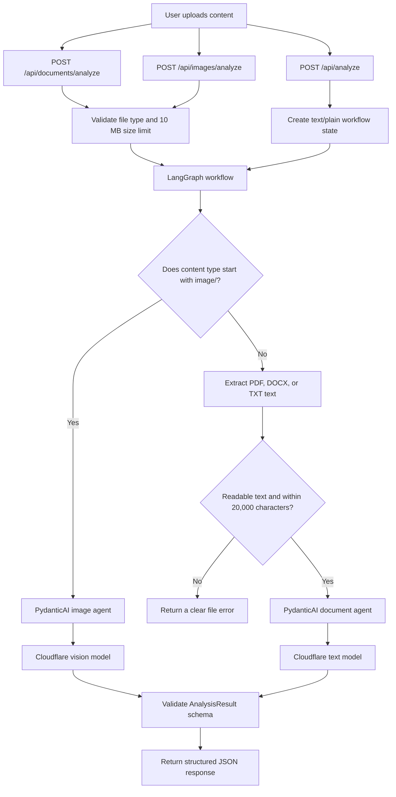

# Docu Gentlemen
AI analysis for business documents and images using Cloudflare Workers AI. PDF, DOCX, and TXT files go through text extraction; JPG, PNG, and WEBP files go through a separate vision route. LangGraph routes each request to a PydanticAI agent, which returns a validated analysis schema.

## Cloudflare model setup

Create a Cloudflare API token with `Workers AI - Read` and `Workers AI - Edit` permissions, then copy the example environment file and add your account credentials:

```bash
cp backend/.env.example backend/.env
```

`CLOUDFLARE_MODEL` configures the text model, while `CLOUDFLARE_VISION_MODEL` configures image analysis. The defaults use Llama 3.1 8B for text and Llama 3.2 11B Vision for images. Llama 3.2 11B Vision requires a one-time acceptance of Meta's license and acceptable use policy before first use. Cloudflare currently includes 10,000 Workers AI Neurons per day on the Free plan; see [current pricing and limits](https://developers.cloudflare.com/workers-ai/platform/pricing/) for details.

## Run the backend

From the repository root, activate the Conda environment and install the backend dependencies:

```bash
conda activate samjhao-ai
python -m pip install -r backend/requirements.txt
```

Start the development server from the repository root:

```bash
python -m uvicorn main:app --app-dir backend --reload
```

Open `http://127.0.0.1:8000/docs` for the API docs. The health endpoint is `http://127.0.0.1:8000/api/health`.

### Backend layout

```text
backend/app/
├── agents/                 # PydanticAI document and image agents, Cloudflare model setup
├── api/routes/             # FastAPI endpoints, separated by route
├── core/                   # Runtime configuration
├── prompts/                # Agent instructions
├── schemas/                # Pydantic request and response models
├── services/               # Upload validation and format-specific extraction
└── workflows/              # LangGraph file type routing and analysis flow
```

The upload endpoints are `POST /api/documents/analyze` for PDF/DOCX/TXT and `POST /api/images/analyze` for JPG/PNG/WEBP. `POST /api/analyze` accepts plain text.

### Analysis flow



The document and image endpoints validate their allowed file types before starting the graph. Inside LangGraph, the image MIME type selects the vision branch; PDF, DOCX, TXT, and plain-text requests use the extraction and document-analysis branch.

### Live terminal logs

Run the backend normally with Uvicorn. It prints one box at each workflow step, and the short request ID lets you follow one request when multiple uploads are processing:

```text
┌────────────────────────────────────────────────────────────────────────┐
│ a1b2c3d4 | LANGGRAPH ROUTING                                           │
│ image/png → image branch (vision agent → Cloudflare vision model)      │
└────────────────────────────────────────────────────────────────────────┘
┌────────────────────────────────────────────────────────────────────────┐
│ a1b2c3d4 | IMAGE AGENT                                                 │
│ Cloudflare vision model | image/png | 84,212 bytes                     │
└────────────────────────────────────────────────────────────────────────┘
```

Document requests additionally show upload validation, text extraction, the document agent, and the final API response. Uploaded content itself is not written to these flow logs.

## Run the React frontend

Keep the backend running, open a second terminal from the repository root, then run:

```bash
cd frontend
npm install
npm run dev
```

Open `http://localhost:5173`. The Vite dev server forwards `/api` requests to the backend at `http://127.0.0.1:8000`.

## Free deployment (separate frontend and backend)

The React/Vite frontend can run on Cloudflare Pages and the FastAPI backend on Render. The backend calls Cloudflare Workers AI directly, so it needs Cloudflare credentials but does not need a separate model server.

### 1. Deploy the backend on Render

Create a **Web Service** from this repository and set:

- Root directory: `backend`
- Build command: `pip install -r requirements.txt`
- Start command: `python -m uvicorn main:app --host 0.0.0.0 --port $PORT`
- Instance type: **Free**
- Health check path: `/api/health`

Add these environment variables in Render:

```text
CLOUDFLARE_ACCOUNT_ID=your-account-id
CLOUDFLARE_API_TOKEN=your-api-token
CLOUDFLARE_MODEL=@cf/meta/llama-3.1-8b-instruct
CLOUDFLARE_VISION_MODEL=@cf/meta/llama-3.2-11b-vision-instruct
CORS_ORIGINS=https://your-project.pages.dev
```

Set `CORS_ORIGINS` to the exact `https://...pages.dev` origin with no trailing slash. The backend will be available at a Render URL such as `https://your-api.onrender.com`.

### 2. Deploy the frontend on Cloudflare Pages

Create a Pages project from the same repository with:

- Root directory: `frontend`
- Build command: `npm run build`
- Build output directory: `dist`

Add this Pages environment variable for the production environment, then deploy:

```text
VITE_API_BASE_URL=https://your-api.onrender.com
NODE_VERSION=22
```

Use the backend's base URL only (no `/api` suffix). Once Pages gives you its `https://...pages.dev` URL, add that exact URL to Render's `CORS_ORIGINS` and redeploy the backend if needed. The Vite proxy remains enabled for local development.

### Free-tier behavior

- Render's free backend sleeps after 15 minutes without traffic; its first request after sleeping can take about a minute. Its filesystem is temporary, so don't use it to store uploaded files or durable records.
- The current document history is held in browser memory and clears when the page reloads. This setup does not add a database.
- Model inference uses Cloudflare Workers AI. Its included allocation and any additional charges depend on current Cloudflare pricing and usage limits.
